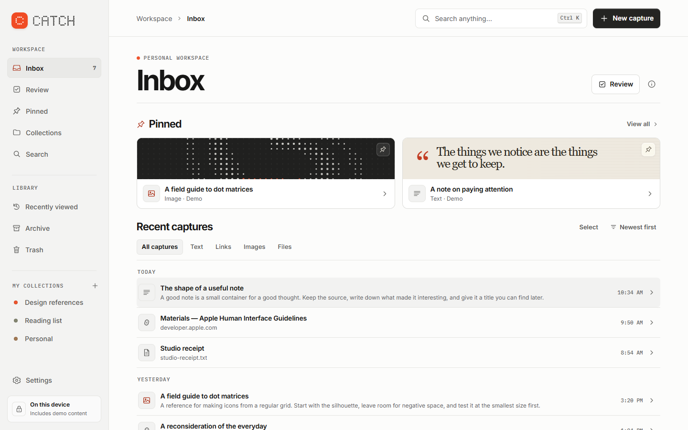

# Catch

**Copy anything. Forget nothing.**

Catch 0.2.1 keeps copied notes, screenshots, links and documents in a local library. It preserves original files and lets you search their words, concepts and supporting passages. Browser capture is manual. The Windows edition adds an opt-in clipboard monitor and a tray.

## Run locally

Use Node 24 or a newer supported Node release. The browser needs a current Chromium-capable browser for the fully verified offline and inference paths.

~~~powershell
npm ci
npm run dev
~~~

Open [the browser development preview](http://127.0.0.1:4177/). To serve the production bundle under a static repository-style path:

~~~powershell
npm run build
node scripts/serve.mjs
~~~

Open [the production-style preview](http://127.0.0.1:4280/catch/). The production app uses relative asset paths, hash navigation and a scoped service worker. The repository includes a manually triggered GitHub Pages workflow for an approved deployment.

## Windows

Unpack the portable ZIP and run **Catch.exe** from the extracted folder. Keep its companion files. For a source checkout:

~~~powershell
npm exec -- install-electron
npm run build
npm run desktop
npm run package:windows
~~~

The packaging command writes the Windows x64 folder, a ZIP and SHA-256 checksums under `release/0.2.1`. The application is unsigned, and Windows may display a SmartScreen warning. Exit Catch from the tray when done. Deleting the extracted portable folder removes the program. The local Electron library remains in the Windows user profile until separately removed.

## Capture and retrieve

- Create a capture with **Ctrl Shift Space**. Open search with **Ctrl K**.
- Search defaults to keyword mode. With MiniLM installed and enabled, the default is hybrid with priority for complete reference-code matches. Keyword and semantic modes are also available.
- Attach up to eight files, 25 MB each and 60 MB total. Catch stores many file types. Text extraction is limited to supported images, PDF, DOCX and plain-text formats such as TXT, Markdown and CSV.
- Browse with pinned captures, tags, collections, recently viewed, Archive and Trash. Restore a deleted item from Trash before permanently deleting it.
- Use Review for suggested categories and tags, evidence-linked dates and amounts, potential tasks and duplicate comparisons.
- Automatic category suggestions are off by default. The local classifier may abstain or choose the wrong label, and suggestions wait for review.
- Export a JSON backup or preview a merge from Settings. Browser and Windows storage stay separate.

## Local models

In Settings, download either model on purpose. No subscription or external inference endpoint is required.

| Feature | Model | Artifact size | Runtime |
| --- | --- | ---: | --- |
| Semantic search and category suggestions | Xenova/all-MiniLM-L6-v2 q8, revision 751bff37182d3f1213fa05d7196b954e230abad9, Apache-2.0 | 23,685,047 bytes | Transformers.js 4.3.2 and ONNX Runtime Web CPU |
| English OCR | Tessdata Fast English 4.1.0, Apache-2.0 | 4,113,088 bytes | Tesseract.js 7 WebAssembly worker |

Runtime assets are served with the application and cached separately. The browser can browse, capture, search, edit and restore backups after the shell is cached. Semantic search and OCR require installed models and cached runtimes. PDF extraction processes up to 40 pages and English OCR up to three scanned pages per PDF. Text in other languages may be stored as typed. The evaluated OCR engine is English only.

## Verification and research

- [Implemented architecture](ARCHITECTURE.md)
- [Test environment and evidence](TEST-REPORT.md)
- [Benchmark results](BENCHMARKS.md) and [research methodology](RESEARCH.md)
- [Privacy](PRIVACY.md) and [security model](SECURITY.md)
- [Asset credits](ASSETS.md) and [third-party notices](THIRD-PARTY-NOTICES.md)
- [Portfolio and interview walkthrough](PORTFOLIO.md)
- [Implementation status](IMPLEMENTATION-STATUS.md) and [changes](CHANGELOG.md)
